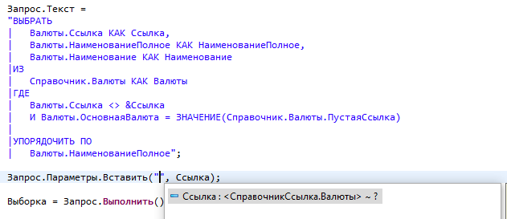
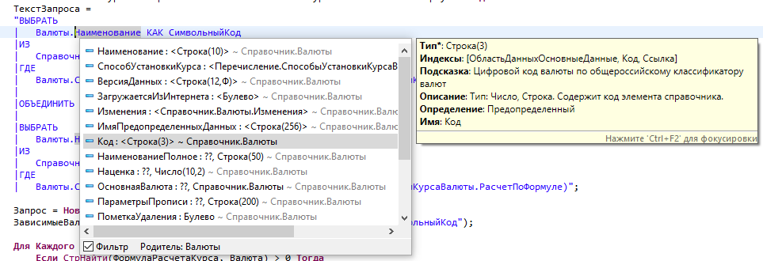
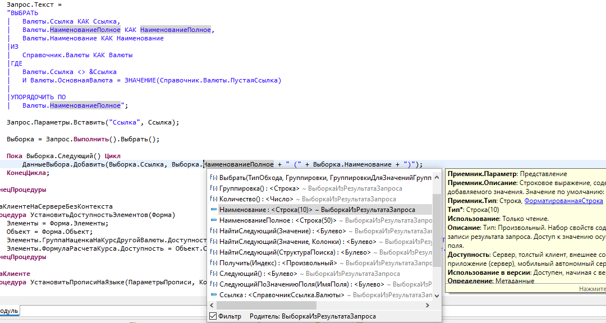

# Автодополнение

Улучшение контекстной подсказки (**content assist**) в **редакторе BSL** — модули объектов, форм, общие модули, а также поля условия и значения выражения в диалоге **«Свойства для …»** точки останова и поле выражения [окна инспектора](inspektor-peremennyh.md). Окно редактора модуля — см. [Редактор модуля](redaktor-modulya.md).

## Настройки

| Параметр                             | Где                                 | Эффект                                                                            |
| ------------------------------------ | ----------------------------------- | --------------------------------------------------------------------------------- |
| **Улучшать списки**                  | Параметры → Комфорт                 | **Обязательна** для всех улучшений подсказки; при выключении — штатный assist EDT |
| **Автооткрытие подсказок при вводе** | Параметры → Комфорт → Редактор кода | Открывает popup при вводе (см. триггеры ниже); по умолчанию **включено**          |
| **Предложение Напарника наверху списка автодополнения** | Параметры → Комфорт → Редактор кода | Первая строка списка — [предложение 1С:Напарника](#predlozhenie-naparnika); по умолчанию **выключено** |
| **Сворачивать параметры в списке автодополнения** | Параметры → Комфорт → Редактор кода | В подписи метода вместо имён параметров — их число: `Метод(3)`; по умолчанию **включено** |
| **Задержка боковой подсказки списка (мс)** | Параметры → Комфорт → Редактор кода | Пауза после смены строки списка до обновления боковой подсказки; по умолчанию **300** (штатно в EDT — 500) |

Без **Улучшать списки** настройки страницы «Редактор кода» не включают улучшенный assist — остаётся только штатное поведение EDT (в т.ч. его автооткрытие, если оно включено).

Алгоритм фильтрации совпадает с [фильтрами по подстроке в списках](obshchie-mekhanizmy.md#filtry-po-podstroke-v-spiskah): текст дробится на фрагменты по пробелам, для совпадения нужно вхождение **каждого** фрагмента (с мягким учётом порядка).

## Умный фильтр и панель popup

При включённом **Улучшать списки**:

- Список **фильтруется по мере ввода** идентификатора — не штатный prefix-match EDT.
- Внизу popup — панель с флажком **Фильтр** (по умолчанию **включён**) и подписью **Родитель:** — тип объекта слева от точки в выражении (`Объект.Свойство`). В строковом литерале при подключённом ИР **Родитель:** показывает контекст из ИР. Имена типов метаданных в списке и в **Родитель:** показываются по-русски (`ОбщийМодуль.ОбщегоНазначения`, а не `CommonModule.ОбщегоНазначения`).
- При вставке выбранного слова, если каретка стоит сразу после `=` и перед знаком есть пробел, перед словом тоже вставляется пробел (`А =` → `А = Слово`). Если пробела перед `=` нет (`А=`), лишний пробел не добавляется.
- Недописанное слово у каретки не предлагается как локальная переменная: Enter и Tab выбирают настоящее имя (`кар` → `Карточка`), а не обрывок. Уже объявленная или использованная переменная с тем же текстом в списке остаётся.
- В строковом литерале с текстом запроса (начинается с `ВЫБРАТЬ` или `УНИЧТОЖИТЬ`) без подключённого ИР список даёт язык запросов — те же варианты, что в окне **«Редактор запроса»**: таблицы, поля, функции и ключевые слова. Выбранный вариант вставляется по правилам литерала: новые строки — с `|`, кавычки удваиваются ([#837](https://github.com/tormozit/EDT.Comfort/issues/837)).
- Без подключённого ИР в комментариях и строковых литералах неизвестного назначения **Ctrl+Space** предлагает имена типов и общих модулей. После точки справа от имени модуля или типа предлагаются его свойства и методы. Плагин дожидается завершения штатного заполнения EDT: если список пуст или содержит только шаблоны и Напарника, добавляются варианты Комфорта. При наличии других штатных вариантов используется заполнение EDT ([#844](https://github.com/tormozit/EDT.Comfort/issues/844)).
- **Ctrl+Space при открытом popup** — переключить фильтр: отфильтрованный список ↔ полный список (повторное Ctrl+Space). Штатное повторное открытие assist EDT в этом режиме не дублируется.
- Флажок **Фильтр** на панели — то же переключение, что Ctrl+Space при открытом popup.
- В строке списка показывается тип значения функции конфигурации. Тип экспортной функции (в том числе своего модуля) берётся из данных сборки, как в подсказке EDT, — сразу при показе строки. Для модуля, открытого в редакторе (в том числе изменённого и не сохранённого), берутся типы, уже рассчитанные EDT в этом редакторе, — те же, что в его боковой подсказке. Пока тип уточняется (идёт сборка или чтение модуля), он помечен `?` и может измениться через несколько секунд: последний известный тип или тип из комментария «Возвращаемое значение» (`: <?, Строка>`), без них — `: <?>`. Так же тип функции показывается в заголовке подсказки при наведении. У переменных в строке списка показывается их тип в месте ввода, уже рассчитанный EDT ([#877](https://github.com/tormozit/EDT.Comfort/issues/877)).

Доработки расчёта типов (несколько типов через запятую, флажок **Расширенный расчет типов**, тип формы) — в разделе [Расчет типов](raschet-tipov.md).

## Расширенный расчет типов :id=extended-types

Раздел перенесён: [Расчет типов → Расширенный расчет типов](raschet-tipov.md#extended-types).

## Автооткрытие при вводе

Если включено **Автооткрытие подсказок при вводе** и **Улучшать списки**, popup открывается при вводе (с учётом **задержки**):

- буквы кириллицы и латиницы;
- `.` после идентификатора (member-access);
- `_`, `&`, `~`, `#`;
- `=` и пробел в подходящем контексте;
- `"` внутри строкового литерала.

В **строчных комментариях** (`//`) автооткрытие срабатывает после `см. ` (в том числе при вставке шаблона) и для member-access: точка после идентификатора или буквы после точки.

В **строковых литералах** без подключённого ИР окно открывается само, только когда назначение литерала известно: у EDT есть для него свои варианты (`Тип("`, `ПолучитьФорму("` и т. п.) или литерал содержит текст запроса. В литерале неизвестного назначения (`ф = ""`, `Сообщить("")`) список открывается только по **Ctrl+Space**.

В первом аргументе `Запрос.УстановитьПараметр("` при включённом [расширенном расчёте типов](raschet-tipov.md#extended-types) окно открывается само со списком параметров текста этого запроса. Без расширенного расчёта типов окно здесь само не открывается.

В литерале и комментарии после имени типа, вида метаданных или общего модуля с точкой (`Справочник.С`) окно открывается само на первой букве после точки и предлагает его свойства, методы или объекты. Сразу после точки окно не открывается.

Набор символов-триггеров в интерфейсе **не настраивается** (задан в плагине).

## Дополнение от ИР

При подключённом [приложении ИР](obshchie-mekhanizmy.md#integraciya-s-ir) и включённом **Улучшать списки**:

- В список **добавляются строки ИР** — формат `Имя : <Тип> ~ Родитель`, у методов в имени — `()`.
- При выборе строки в боковой панели показывается **HTML-описание** из ИР (как в редакторе ИР).
- **Ctrl+Space при закрытом popup** — запросить или обновить подсказку с учётом данных ИР (при отсутствии сеанса ИР команда не перехватывается).
- **Строковые литералы** BSL (в т.ч. многострочные): штатные варианты EDT плюс слова ИР; удобно для текста запросов, путей и произвольных строк в кавычках.
- Устранено протухание кэша слов глобального контекста ЕДТ при подключённом ИР.
- **Выделенный фрагмент + Ctrl+Space** — список заполняется **только словами ИР** (варианты EDT не подмешиваются) и не сужается по тексту выделения: подсказка даётся по выражению целиком. Повторное Ctrl+Space переключает фильтр как обычно ([#198](https://github.com/tormozit/EDT.Comfort/issues/198)).
## Предложение Напарника :id=predlozhenie-naparnika

Если включены **Предложение Напарника наверху списка автодополнения** и **Улучшать списки**, а в редакторе работает плагин **1С:Напарник**, первая строка списка автодополнения отведена его предложению ([#759](https://github.com/tormozit/EDT.Comfort/issues/759)).

- Строка Напарника выделена своим значком и цветом текста. При открытии списка текущей остаётся обычная строка под ней.
- Пока Напарник думает, в его строке показано `...`; если ответ пустой или непригоден — `ИИ не знает`. Если запрос завершился ошибкой, в строке показано `<ошибка>`, а текст ошибки — в боковой подсказке этой строки.
- В запрос уходят текст модуля у каретки и слова списка. Какая строка списка текущая, Напарнику не сообщается.
- Строка заполняется, когда пришла первая целая строка предложения; дальше предложение дополняется тоже целыми строками.
- Пока набираемый текст совпадает с началом предложения, оно сохраняется; иначе строка снова показывает `...` и предложение запрашивается заново.
- У текущей строки Напарника в боковой подсказке показан полный текст предложения с раскраской встроенного языка.
- Клавиши действуют, когда строка Напарника текущая: **Enter** вставляет верхнюю строку предложения и снова открывает список с остатком предложения, **Ctrl+Enter** вставляет предложение целиком, **Tab** вставляет очередное слово, закрывает список и показывает остаток предложения подсказкой Напарника прямо в тексте — дальше он принимается клавишами самого Напарника.
- Если список открыт по **Ctrl+Space**, строка Напарника показывается и тогда, когда других слов нет; при автооткрытии список без слов не открывается.

Строка показывается при любой политике завершения кода Напарника, кроме **«Выключен»** (в том числе при **«Ручной»**). При политике **«Выключен»** запросы не выполняются; строка остаётся только если последний запрос завершился ошибкой — тогда она показывает `<ошибка>` и текст этой ошибки.

## Иллюстрации

Подсказка для параметра запроса по контексту строки запроса:

Список с данными ИР и HTML-описанием:

Подсказка внутри строкового литерала:

## Исправления

- Исправлено автооткрытие автодополнения при вводе `&` ([#125](https://github.com/tormozit/EDT.Comfort/issues/125)).
- При вставке платформенных методов и конструкторов типов подставляются только **обязательные** параметры — лишние запятые необязательных параметров больше не добавляются ([#264](https://github.com/tormozit/EDT.Comfort/issues/264)).

## Ограничения

- **Редактор BSL** (модули), поля условия / значения выражения в диалоге [точки останова](tochki-ostanova.md) и поле выражения [инспектора переменных](inspektor-peremennyh.md); другие текстовые редакторы EDT не затрагиваются (кроме [редакторов запросов](redaktor-zaprosa.md) — см. ниже).
- В полях точки останова и инспектора в список не подмешиваются строки ИР — только варианты EDT с умным фильтром и автооткрытием.
- Функции ИР: **Windows**, **COM**, обработка ИР в базе — см. [Известные ограничения](izvestnye-ogranicheniya.md).
- Отдельной команды и привязки в [Горячие клавиши](goryachie-klavishi.md) нет; **Ctrl+Space** описан в этом разделе.

## Связанные разделы

- [Автодополнение](avtodopolnenie.md)
- [Точки останова](tochki-ostanova.md) — автооткрытие в поле условия ([#274](https://github.com/tormozit/EDT.Comfort/issues/274))
- [Инспектор переменных](inspektor-peremennyh.md) — языковые подсказки в поле выражения ([#499](https://github.com/tormozit/EDT.Comfort/issues/499))
- [Редактор запроса](redaktor-zaprosa.md) — модификация автодополнения для языка запросов ([#132](https://github.com/tormozit/EDT.Comfort/issues/132))
- [Расчет типов](raschet-tipov.md)
- [Настройки](nastroyki.md)
- [Общие механизмы → Фильтры по подстроке](obshchie-mekhanizmy.md#filtry-po-podstroke-v-spiskah)

