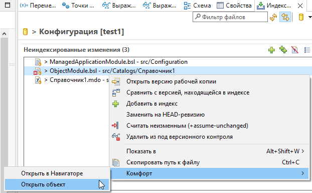
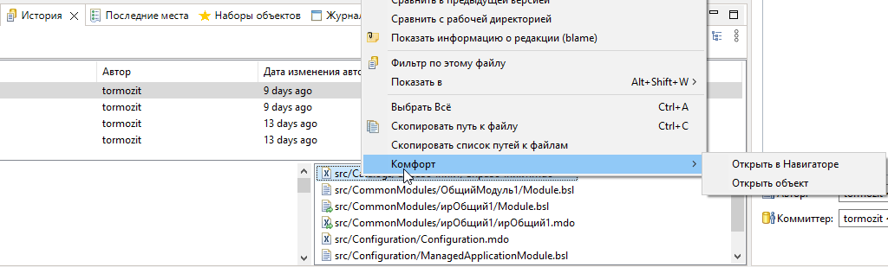

# Git: история и изменённые файлы

В списках файлов панелей **Индексирование Git** и **История Git** меню **Колонки** позволяет показывать и скрывать дополнительные колонки. Пометки сохраняются после закрытия панели и перезапуска EDT. В панели **Индексирование Git** выбор общий для списков **Индексированные изменения** и **Неиндексированные изменения**.

Команды и доработки Комфорт в представлениях Git в EDT.

В панели **«Индексирование Git»** иконки файлов модулей получают тот же индикатор критичности проблем, что и вкладки модулей в редакторе объекта. Он отражает проблемы самого файла и обновляется при изменении результатов проверок EDT; значок состояния файла Git сохраняется ([#747](https://github.com/tormozit/EDT.Comfort/issues/747)).

## Где работает
- панель **«Индексирование Git»**;
- панель **«История»**;
- окно **«Результат получения изменений»**.

## Проверка ссылок перед фиксацией

Проверки этого и двух следующих разделов отключаются флажком [**«Контролировать ссылки метаданных в ключевых операциях»**](nastroyki.md#kontrol-ssylok).

Кнопки **«Фиксировать»** и **«Фиксировать и отправить»** в панели **«Индексирование Git»** проверяют битые ссылки метаданных в составе коммита ([#668](https://github.com/tormozit/EDT.Comfort/issues/668)). Проверяется индекс Git. Обычно проверяются только файлы коммита. Если удаляется объект, в том числе вложенный объект внутри изменённого файла, проверяется вся итоговая конфигурация, включая ранее зафиксированные объекты. Репозиторий не копируется: проверка читает нужные файлы непосредственно из Git. Так же работают эти кнопки в окне **«Фиксировать изменения»**; там проверяются помеченные файлы рабочего каталога.

Ограничения по времени у проверки нет. При удалениях поиск в неизменённых объектах запускается независимо от списка «Неиндексированные изменения». Через **10 секунд** любой проверки, включая подготовку модели, уже найденные битые ссылки показываются в панели **«Поиск»** и появляется диалог **«Проверка битых ссылок может занять длительное время»** с кнопками **«Продолжить проверку»**, **«Пропустить проверку»**, **«Отменить фиксацию»**. Первая продолжает поиск до конца; вторая прерывает проверку и продолжает фиксацию; третья отменяет проверку и фиксацию. Закрытие этого диалога также отменяет фиксацию. Найденные ссылки показываются в панели **«Поиск»**. При завершённой проверке появляется вопрос **«Коммит содержит битые ссылки на метаданные (показаны в панели Поиск). Продолжить?»**. Ответ **«Нет»** отменяет фиксацию, **«Да»** продолжает штатное действие кнопки. Ошибка проверки не отменяет фиксацию. Если открыто несколько проектов конфигураций, их результаты доступны через историю поиска. Автоматические коммиты слияния проверку не запускают.

## Проверка ссылок перед заменой на HEAD-ревизию и удалением файла

Так же проверяются две операции панели **«Индексирование Git»**: **«Заменить на HEAD-ревизию»** и удаление файла из списка **«Неиндексированные изменения»** (пункт меню и клавиша **Delete**). Проверяется рабочий каталог, каким он станет после операции: если она удаляет объект, в том числе вложенный, проверяется вся конфигурация. Учитываются только ссылки, которые станут битыми из-за операции: уже битые ссылки рабочего каталога не показываются. Найденные ссылки показываются в панели **«Поиск»**, и появляется вопрос **«Операция приведет к появлению битых ссылок на метаданные (показаны в панели Поиск). Продолжить?»**. Ответ **«Нет»** отменяет операцию. Диалог длительной проверки — тот же, что при фиксации; пропуск или ошибка проверки операцию не отменяют.

## Проверка недостижимых файлов метаданных :id=nedostizhimye-fajly-git

Сразу после проверки ссылок те же действия — фиксация, **«Заменить на HEAD-ревизию»** и удаление файла — проверяются на [недостижимые файлы метаданных](struktura-proekta.md#nedostizhimye-fajly) ([#754](https://github.com/tormozit/EDT.Comfort/issues/754)). Проверяется каждый файл, который действие создаёт; если из `Configuration.mdo` убираются объекты — все файлы итогового состава. Для замены на HEAD-ревизию и удаления показываются только папки, которые становятся недостижимыми из-за самой операции. Найденные папки показываются в панели **«Поиск»**, и появляется вопрос **«Коммит содержит недостижимые файлы метаданных (показаны в панели Поиск). Продолжить?»** (для операций — **«Операция приведет к появлению недостижимых файлов метаданных…»**). Ответ **«Нет»** отменяет действие. Для папок, найденных при фиксации из панели **«Индексирование Git»**, команда **«Подключить к родителю»** добавляет файл родителя (`Configuration.mdo` или mdo владельца) в **«Индексированные изменения»**; если указатель на объект в рабочем каталоге уже есть, файл не правится, а только индексируется. Пропуск проверки ссылок пропускает и эту проверку; её ошибка действие не отменяет.

## Команды в списках файлов
В списках изменённых файлов конфигурации — подменю **Комфорт**:
| Действие | Клавиши | Описание |
|----------|---------|----------|
| Открыть в Навигаторе | Ctrl+T | Выделить соответствующий объект в [навигаторе](navigator.md) |
| Открыть объект | F2 | Открыть объект метаданных в редакторе EDT |
| Свернуть все другие | — | В деревьях файлов — свернуть все ветки, кроме родителей выделения ([общие механизмы](obshchie-mekhanizmy.md#svernut-vse-drugie)) |
Команды доступны при выборе файла конфигурации, для которого удаётся определить объект метаданных. При нескольких выделенных файлах команды открытия и навигации относятся к **текущей строке**.

## История
Если связь с текущим редактором выключена, панель при открытии автоматически выбирает единственный доступный репозиторий. Если репозиториев несколько, восстанавливается последний выбранный, пока он остаётся в списке репозиториев. Выбор сохраняется между запусками EDT. Если сохранённого выбора нет, показывается история репозитория активного проекта или первого доступного. Репозиторий выбирается в подменю панели инструментов.
В панели поиска коммитов (поле **«Найти»**) запоминаются последние запросы: кнопка **▾** у поля и **Ctrl+↓**. История сохраняется между запусками EDT.
В списке файлов коммита — колонки **«Файл»**, **«Тип»**, **«Путь»** (полное имя объекта метаданных) и **«Статус»** (Добавлен / Изменён / Удалён / …); сортировка по клику на заголовок колонки; поле [фильтра](obshchie-mekhanizmy.md#filtry-po-podstroke-v-spiskah) с раскраской вхождений ([#184](https://github.com/tormozit/EDT.Comfort/issues/184), [#230](https://github.com/tormozit/EDT.Comfort/issues/230)). **Ctrl+C** копирует текст активной ячейки.
В подменю **Комфорт** списка файлов коммита — команда **«История ИР»**: открывает инструмент «История Гита» в приложении ИР с отбором по файлу и коммиту ([#113](https://github.com/tormozit/EDT.Comfort/issues/113)).
В контекстном меню таблицы — команды **отбора по значению ячейки** («Отобрать», «Снять отбор», «Различные значения колонки», «Отключить все отборы») — см. [Отбор по значению колонки](obshchie-mekhanizmy.md#otbor-po-znacheniyu-kolonki).
Модуль, открытый из коммита (вкладка вида «Module.bsl …»), подсвечивает текущий идентификатор так же, как редактор модуля проекта — см. [Выделение текущего идентификатора](redaktor-modulya.md#vydelenie-tekushchego-identifikatora).
В контекстном меню списка **коммитов** — команда **«Сравнить рабочий каталог с коммитом»** ([#21](https://github.com/tormozit/EDT.Comfort/issues/21)). Сравниваемый проект определяется по репозиторию самой панели «История» (не по активному редактору); если репозиторию соответствует несколько открытых проектов — предлагается выбрать проект.
Если в списке коммитов включён отбор **«Все изменения ресурса»**, то по окончании построения дерева различий в нём автоматически выделяется строка объекта, открытого в активном редакторе (если этот объект есть в сравнении). Фокус при этом передаётся дереву только тогда, когда редактор сравнения и так активен.
В диалоге **«Выбор коммита»** (команды сравнения с коммитом) — флажок **«Разрешить удаление объектов главного источника»** под штатными настройками. По умолчанию **включён** (штатное поведение); при снятии сравнение не предлагает удалять объекты, присутствующие только в главном источнике ([#242](https://github.com/tormozit/EDT.Comfort/issues/242)). Там же запоминаются размер окна и состояние штатного флажка **«Сравнивать модули с учетом структуры»** — при следующем открытии диалог восстанавливает их.
В области отличий коммита для модулей (`.bsl`) после заголовка каждого блока изменений `@@ … @@` показано имя метода, в котором находится изменение. Справа от текста — узкий список методов с изменениями по алфавиту: выбор строки прокручивает текст к первому изменению метода. Список есть, когда включена настройка **«Улучшать списки»**; его ширина запоминается. Скрыть список можно пометкой **«Показывать список методов»** в контекстном меню текста. Если текст изменений обрезан по настройке **«Максимум строк»**, строка обрезки — ссылка: щелчок открывает полное сравнение файла, а в списке методов ей соответствует последняя строка **«<текст обрезан>»**. То же — в панели [«Изменения файла Git»](#izmeneniya-fajla-git).
В области отличий коммита работают клавиши поиска редактора: **Ctrl+F** открывает окно **«Найти/Заменить»**, **Ctrl+F3** / **Ctrl+Shift+F3** ищут вперёд и назад выделенный текст или слово под курсором, **F3** / **Shift+F3** — следующее и предыдущее вхождение. То же — в панели [«Изменения файла Git»](#izmeneniya-fajla-git).
### Поиск в изменениях файлов :id=poisk-v-izmeneniyah-fajlov
Штатный поиск на вкладке **«Поиск в Git»** окна **«Поиск»** просматривает только реквизиты коммитов. Область **«Изменения файлов»** в группе **«Область»** ищет текст из поля **«Содержит текст»** в добавленных и удалённых строках файлов ([#761](https://github.com/tormozit/EDT.Comfort/issues/761)). Она альтернативна остальным областям: при её включении они и список репозиториев недоступны, поиск идёт по репозиторию активного проекта. Нужен установленный Git.
С пометкой **«Регулярное выражение»** выражение разбирает сам Git (расширенный синтаксис POSIX), поэтому `\d`, `(?i)` и точка на месте русской буквы не работают — подробности в подсказке флажка.
Поле **«Маска имени файла»** ограничивает поиск файлами, путь которых подходит под маску. Несколько масок перечисляются через `|`, например `*.bsl|Справочники`; маска без `*` ищется как часть пути. Последние маски запоминаются.
Найденные коммиты показывает панель **«История Git»**: над списком коммитов появляется цветная полоса с искомым текстом и числом найденных коммитов, список пополняется по ходу поиска. Ссылки полосы: **«Остановить»** — прервать поиск, **«Все файлы коммита»** — показать в списке файлов не только файлы с совпадением, **«Закрыть»** — вернуться к обычной истории.
У выбранного коммита в списке файлов остаются и выделяются только файлы с совпадением; щелчок по файлу передаёт фокус тексту отличий. В области отличий все вхождения искомого текста окрашены, курсор встаёт на первое. Если текст отличий обрезан по настройке **«Максимум строк»** и искомое осталось за обрезкой, вхождением считается сама строка обрезки; полное сравнение, открытое по ней, сразу встаёт на первое вхождение в изменённой строке и выделяет его. Команды **«Следующее вхождение»** и **«Предыдущее вхождение»** контекстного меню области переходят между вхождениями по кругу; то же делают **F3** и **Shift+F3**, пока в этом тексте не нажат **Ctrl+F3**.
Кнопка **«Найденное»** на панели инструментов панели **«История Git»** — как список прошлых поисков в панели **«Поиск»**: выпадающий список хранит поиски текущего сеанса EDT и возвращает к любому из них, щелчок по самой кнопке показывает последний.
## Индексирование Git
При открытии панели автоматически выбирается единственный доступный репозиторий. Если репозиториев несколько, восстанавливается последний выбранный, пока он остаётся в списке репозиториев. Выбор сохраняется между запусками EDT.
Дерево файлов получает колонки **«Имя»**, **«Тип»**, **«Путь»** (полное имя метаданных), **«Время изменения»** и **«Статус»**; фильтр — многословный с историей и раскраской ([#183](https://github.com/tormozit/EDT.Comfort/issues/183), [#230](https://github.com/tormozit/EDT.Comfort/issues/230), [#267](https://github.com/tormozit/EDT.Comfort/issues/267)). **Ctrl+C** копирует текст активной ячейки; при нескольких выделенных строках — ячейки активной колонки по всем выделенным строкам.
Порядок и ширины колонок синхронизируются между списками «Индексированные изменения» и «Неиндексированные изменения»; колонки растягиваются и сужаются вместе с панелью — см. [Порядок и ширина колонок](obshchie-mekhanizmy.md#poryadok-i-shirina-kolonok).
В контекстном меню дерева — команды **отбора по значению ячейки** (см. [Отбор по значению колонки](obshchie-mekhanizmy.md#otbor-po-znacheniyu-kolonki)).
Перетаскивание объекта метаданных из [навигатора](navigator.md), [последних мест](poslednie-mesta.md) или [наборов объектов](nabory-obektov.md) на список «Индексированные изменения» или «Неиндексированные изменения» снимает текущее выделение в этом списке и выделяет файлы сброшенного объекта — без файлов вложенных объектов (форм, макетов, команд и т.п.).
### Изменения файла Git :id=izmeneniya-fajla-git
Панель **«Изменения файла Git»** показывает компактные изменения файлов, выделенных в списках панели **«Индексирование Git»**, — так же, как область изменений панели **«История»** ([#760](https://github.com/tormozit/EDT.Comfort/issues/760)). Для списка **«Неиндексированные изменения»** сравниваются индекс и рабочий каталог, для списка **«Индексированные изменения»** — HEAD-ревизия и индекс. Панель следует за выделением и обновляется при изменении файлов и индекса; в её заголовке указаны список и файл. Команда контекстного меню **«Показать в редакторе»** открывает файл рабочего каталога на строке, над которой вызвано меню: модуль — в редакторе модуля, остальные файлы — в текстовом редакторе (XML или простом). Открывается кнопкой **«Изменения файла»** на панели инструментов «Индексирования Git», командой **«Показать изменения файла»** подменю **Комфорт** списков файлов или через **Окно → Показать панель → Комфорт**. Предел числа строк и игнорирование пробелов берутся из настроек панели «История».
## Заменить на HEAD ревизию и «осиротевший» mdo :id=osirotevshij-mdo
Если объект метаданных **удалили** в EDT, а затем **восстановили только файлы mdo** через Git (без записи в `Configuration.mdo`), объект не появится в навигаторе и может «пропасть» из сравнения конфигураций. В [структуре проекта](struktura-proekta.md) такая папка помечается суффиксом **` <?>`**.
Команда **«Заменить на HEAD ревизию»** при обнаружении таких файлов **предупреждает** и при согласии **добавляет** указатель на объект в `Configuration.mdo` ([#236](https://github.com/tormozit/EDT.Comfort/issues/236)).
## Configuration.mdo — дубликаты
Перед **выгрузкой** и **обновлением конфигурации БД** Комфорт автоматически удаляет **дубли** child-записей в `Configuration.mdo` (одинаковые строки вида `<reports>Имя</reports>`), которые могут появиться после объединения конфигураций. При обнаружении дублей показывается уведомление с возможностью **«Показать различия»** ([#246](https://github.com/tormozit/EDT.Comfort/issues/246)).
## Отправка на сервер
При ошибке отправки на сервер Git Комфорт показывает [уведомление о завершении](obshchie-mekhanizmy.md#uvedomlenie-o-zavershenii-dlitelnyh-operacij) **«Завершено с ошибкой: Отправка на сервер Git …»**, если штатный диалог **«Результаты отправки»** не появился. Когда этот диалог уже на экране и окно EDT на переднем плане, уведомление не дублирует его ([#340](https://github.com/tormozit/EDT.Comfort/issues/340)).
## Результат получения изменений
В окне **«Результат получения изменений: …»** строки веток получают доработки ([#108](https://github.com/tormozit/EDT.Comfort/issues/108)).
**Двойной клик** по строке ветки показывает эту ветку в панели **«Репозитории Git»**: панель открывается, если была закрыта, и выводится на первый план, если её вытеснила другая вкладка. Если панель уже видна, фокус остаётся в окне результата.
**Контекстное меню** строки ветки содержит команду показа ветки в панели «Репозитории Git» и штатные команды Git над этой веткой: **«Извлечь (checkout)»**, **«Слить (merge)»**, **«Перебазировать»**, **«Создать ветку»**, **«Настроить ветку»**, **«Удалить ветку»**, **«Отправить ветку»**, **«Синхронизировать с рабочим каталогом»**. Команды выполняются так же, как из панели «Репозитории Git». Если команда в текущем состоянии репозитория неприменима, показывается уведомление.

## См. также
- [Структура проекта](struktura-proekta.md)
- [Навигатор](navigator.md)
- [Горячие клавиши → Git](goryachie-klavishi.md#git)
