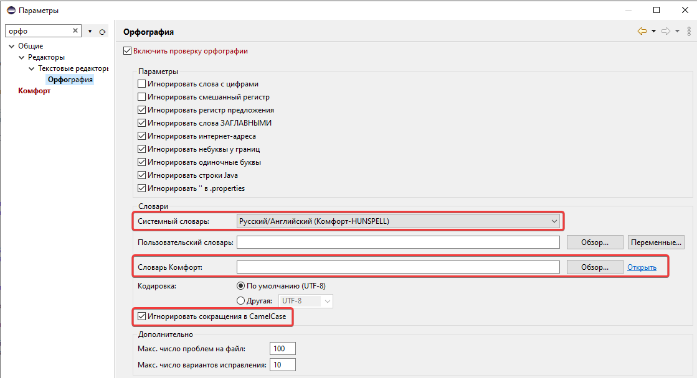
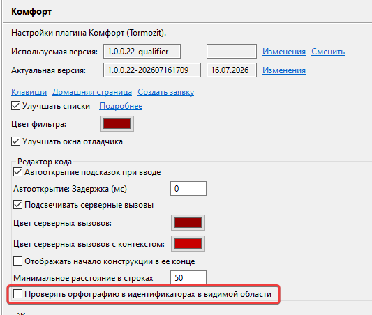
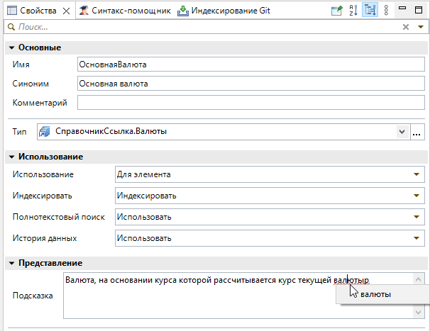
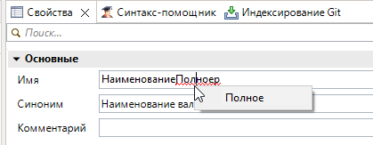
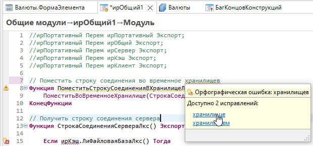
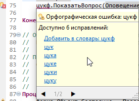
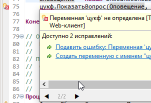
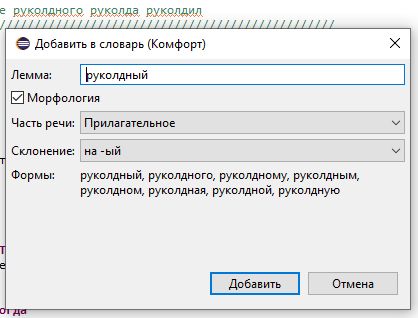
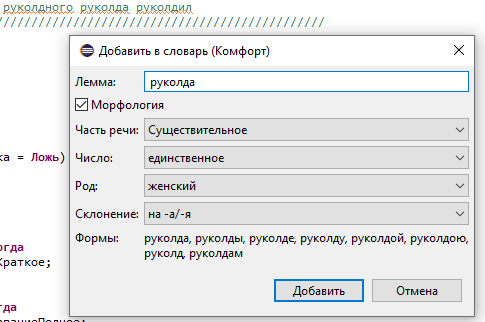

# Орфография

Проверка орфографии в редакторе кода и связанных полях на основе словарей **HUNSPELL** (русский и английский) ([#175](https://github.com/tormozit/EDT.Comfort/issues/175)).

## Требование JDT

Орфография Comfort использует **Eclipse JDT UI** (`org.eclipse.jdt.ui`). Сам плагин Comfort **ставится без JDT** ([#189](https://github.com/tormozit/EDT.Comfort/issues/189)); пока JDT нет — проверка орфографии отключена.

Если в EDT нет JDT UI: **Параметры → Комфорт → Редактор кода** (или **Свойства проекта → Комфорт**) → ссылка **«Установить модуль орфографии (JDT)»** — откроется установщик с сайта Eclipse Releases с уже выбранным **`org.eclipse.jdt.ui`** (минимальный модуль, не весь JDT).

## Подключение словарей

При **первом старте** (если JDT уже есть) плагин подключает поставляемые словари HUNSPELL для русского и английского языков и выставляет рекомендуемые настройки орфографии EDT. Штатная страница **Параметры → Общие → Орфография** переведена на русский.

Пользовательский словарь разделён на **локальный** (рабочая станция) и **проектный** (хранится с проектом). Добавление слова — через диалог **«Добавить в словарь»** или быстрые исправления.

## Разбор идентификаторов

В отличие от штатного токенизатора, слова со смешанным регистром разбиваются на подслова по границам **CamelCase** (заглавные буквы). В комментариях и строковых литералах подслова, стоящие вплотную к цифре («Т1», «Док2»), не проверяются: это обозначение, а не текст.

| Параметр | Где | Описание |
|----------|-----|----------|
| Проверять орфографию в идентификаторах в видимой области | **Параметры → Комфорт → Редактор кода** | Проверка имён в видимой части редактора |
| Игнорировать сокращения в CamelCase | **Параметры → Общие → Орфография** | Короткие фрагменты вроде аббревиатур в CamelCase не помечаются (включён по умолчанию) |

В панели **«Свойства»** и в полях ввода редакторов объектов проверка текста выполняется при получении полем фокуса.

Проверка работает и в окне **«Строки на разных языках»** — в полях всех языков сразу ([#434](https://github.com/tormozit/EDT.Comfort/issues/434)). Ошибочные слова подчёркиваются, варианты замены и **«Добавить в словарь»** доступны по правой кнопке мыши и по Ctrl+1.

В режиме **«Форматированная строка»** этого окна ошибочные слова также подчёркиваются. Правая кнопка мыши на ошибке или Ctrl+1 при каретке в слове открывают варианты замены и команду **«Добавить в словарь»** ([#669](https://github.com/tormozit/EDT.Comfort/issues/669)). Подчёркивания не входят в сохраняемую строку.

В редакторе справки проверка работает на страницах **«Редактирование»**, **«Текст»** и **«Просмотр»**. На странице «Текст» проверяется текстовое содержимое HTML, без тегов, адресов в атрибутах и скриптов. Страница «Просмотр» показывает ошибки и варианты написания, позволяет добавить слово в словарь; для замены слова нужно перейти на «Редактирование» или «Текст».

## Проверка текстов пользователя в конфигурации :id=proverka-tekstov-polzovatelya

Команда **«Комфорт → Проверить орфографию в текстах пользователя»** в контекстном меню навигатора ищет ошибки орфографии в выбранных объектах с вложенными, на корневом узле — во всей конфигурации ([#757](https://github.com/tormozit/EDT.Comfort/issues/757)). Проверка идёт фоновым заданием с прогрессом и возможностью отмены. Слова с заглавной буквой после строчной (вида «CamelCase») пропускаются: это имена, а не слова естественного языка.

Проверяются те же тексты, которые [поиск по конфигурации](rezultaty-poiska.md) находит по флажку **«Строки пользовательского интерфейса»**: синонимы, заголовки, подсказки и другие многоязычные строки объектов, форм и макетов, наименования предопределённых элементов, строковые литералы внутри `НСтр()` в модулях. Словари и правила — те же, что в редакторе, включая общий и проектный словари.

Результат показывается в панели **«Поиск»** в режиме **«Ошибки орфографии»**. Слева — таблица слов с ошибками и числом их вхождений, над ней поле фильтра по слову: выбор слов (одного или нескольких) отбирает строки правой таблицы. Первая строка **«<Все>»** отключает отбор: справа показаны строки всех слов; она остаётся наверху при любой сортировке. Команды **«Добавить в словарь»** и **«Заменить на»** есть и в контекстном меню левой таблицы (для одного выбранного слова; замена применяется ко всем его вхождениям). Справа — таблица с колонками **«Путь»**, **«Свойство»**, **«Текст»** и **«Слово»**, одна строка на каждое слово с ошибкой; слово в тексте выделено. Команда **«Добавить в словарь»** в контекстном меню строки открывает тот же диалог, что и в редакторе; после добавления слова — отсюда или из любого другого места — строки с ним и его формами из результатов убираются. Если у всех выделенных строк слово одно и то же, в меню есть подменю **«Заменить на»** с вариантами исправления (подбираются в фоне, как в полях с проверкой орфографии): выбранный вариант подставляется во всех выделенных строках — и в свойствах объектов, и в модулях; открытый модуль остаётся несохранённым. Для строки модуля в колонке «Свойство» показано имя метода. Двойной клик по строке открывает свойство объекта либо модуль с выделенным словом.

## Проверка всех текстов конфигурации :id=proverka-vseh-tekstov

Команда **«Комфорт → Проверить орфографию во всех текстах»** в контекстном меню навигатора проверяет те же тексты пользователя и дополнительно программные: имена и комментарии объектов, реквизитов, форм и их элементов, имена предопределённых элементов, а в модулях — комментарии, строковые литералы вне `НСтр()` и имена процедур, функций и переменных. Слитные имена проверяются по частям, как в редакторе модуля; ключевые слова языка и имена платформы пропускаются. Имя с ошибкой показывается один раз на модуль — в первом месте, где оно встретилось.

Результат — тот же режим **«Ошибки орфографии»** панели **«Поиск»** с дополнительной колонкой **«Пользовательский»** (в шапке — значок пользователя): пометка в ней отмечает тексты, которые видит пользователь программы. Сортировка по этой колонке разделяет тексты пользователя и программные. Для слова в имени подменю **«Заменить на»** недоступно: имя исправляется переименованием.

## Где проверка не выполняется

В **XML-файлах** (`.mdo` и др.) штатная проверка орфографии EDT отключена: она работает по сырому тексту разметки и даёт бессмысленные подчёркивания ([#262](https://github.com/tormozit/EDT.Comfort/issues/262)). На проверку в модулях BSL, в панели «Свойства» и в комментарии коммита это не влияет.

## Подсказки и быстрые исправления

На ошибочном слове доступны подсказки с вариантами замены, переключением между маркерами и пунктом **«Добавить в словарь»**.

Подсказки нескольких маркеров (переключение страницами в подсказке):

Диалог **«Добавить в словарь»** — с морфологией (формы слова по части речи и склонению):

## См. также

- [Редактор модуля](redaktor-modulya.md)
- [Настройки](nastroyki.md)
