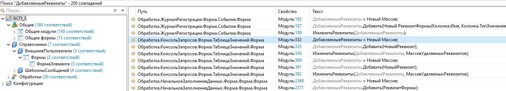

# Результаты поиска
Панель **Результаты поиска** (глобальный поиск по конфигурации EDT).
## Как открыть
Выполните штатный поиск EDT (**Поиск → Поиск…** или **Поиск в конфигурации**) или штатный поиск по файлам (**Поиск → Поиск по файлам…**). Результаты отображаются в представлении **Результаты поиска**.
## Результаты поиска в конфигурации
Для глобального поиска по конфигурации EDT (**Поиск → Поиск…**), а также для результатов команды **«Найти ссылки»**, доступны дополнительные возможности:
| Возможность | Описание |
|-------------|----------|
| Флажок **Слово целиком** | Ограничивает поиск точным совпадением искомого слова, а не подстрокой ([#102](https://github.com/tormozit/EDT.Comfort/issues/102)) |
| Агрегация вхождений | При выборе группового узла в дереве в правой таблице показываются вхождения **всех потомков** ([#79](https://github.com/tormozit/EDT.Comfort/issues/79)) |
| Колонка «Путь» | Полное имя объекта метаданных |
| Колонка «Свойство» | Иерархический путь к найденному свойству внутри объекта |
| Сортировка | Клик по заголовку колонки сортирует таблицу; повторный клик меняет направление |
| Открытие вхождения | Активирует соответствующую страницу редактора (в т.ч. схемы компоновки данных и табличного документа) ([#209](https://github.com/tormozit/EDT.Comfort/issues/209)) и устанавливает фокус на соответствующее поле в панели **Свойства** ([#230](https://github.com/tormozit/EDT.Comfort/issues/230)) |
| Вхождение в составе | Для вхождения в свойстве «Состав» плана обмена или подсистемы открывается редактор владельца на странице **Состав** с активной строкой найденного объекта ([#315](https://github.com/tormozit/EDT.Comfort/issues/315)) |
| Вхождение в правах роли | Для вхождения в правах на объект открывается редактор роли на странице **Права** с активной строкой найденного объекта ([#315](https://github.com/tormozit/EDT.Comfort/issues/315)) |
| Вхождение в составном типе | Для вхождения вида «Реквизиты.Касса.Тип.Типы» у реквизита с составным типом сразу открывается диалог **«Редактирование типа данных»** с активной строкой найденного объекта — поле **Тип** у такого реквизита показывает только «Составной тип» ([#315](https://github.com/tormozit/EDT.Comfort/issues/315)) |
| Перетаскивание на навигатор | Сброс строки дерева или таблицы вхождений на [навигатор](navigator.md) выделяет соответствующий объект (то же, что **Показать в навигаторе**) |
| Замена | Команды **«Заменить выделенные…»** и **«Заменить все…»** в контекстном меню таблицы вхождений и в подменю **«Комфорт»** контекстного меню дерева заменяют текст вхождений — в модулях и в свойствах объектов, включая имена (ссылки на переименованный объект не исправляются). Перед заменой показывается предпросмотр, где можно снять лишние вхождения; объекты, которые нельзя изменять, и вхождения, текст которых изменился после поиска, пропускаются. Заменённые вхождения остаются в списке: в колонке **«Текст»** — строка после замены, в узкой колонке **«Заменено»** (значок в шапке) — пометка; повторно они не заменяются до нового поиска. Только для поиска по тексту, не для **«Найти ссылки»** ([#800](https://github.com/tormozit/EDT.Comfort/issues/800)) |
## Окно «Поиск»
В штатном окне **Поиск → Поиск…** (страница поиска по конфигурации):
| Возможность | Описание |
|-------------|----------|
| Размер окна и списков области | Запоминаются между открытиями; при переключении вкладок окно не расширяется заново ([#367](https://github.com/tormozit/EDT.Comfort/issues/367)) |
| Счётчик типов объектов | В заголовке списка **«среди типов объектов»** в скобках показывается число помеченных типов ([#367](https://github.com/tormozit/EDT.Comfort/issues/367)) |
| Флажок **Слово целиком** | Ограничивает поиск точным совпадением искомого слова, а не подстрокой ([#102](https://github.com/tormozit/EDT.Comfort/issues/102)) |
| Переключатель **«Область поиска»** | Вариант **«Рабочая область»** переименован в **«Вся рабочая область»**, **«Пользовательская область»** — в **«По настроенному отбору»**. Добавлены варианты **«Отобранное в навигаторе»** (результаты ограничиваются объектами, видимыми в навигаторе с учётом его активного отбора — фильтра по подсистемам или по набору; если отбор не включён — ограничения нет) и **«Активные наборы»** (объектами активных [наборов объектов](nabory-obektov.md) всех проектов). Выбранный вариант запоминается между открытиями окна. Поиск при этом идёт по всей рабочей области, а лишние вхождения отсекаются — и в дереве, и в таблице вхождений ([#420](https://github.com/tormozit/EDT.Comfort/issues/420)) |
| Счётчик «Искать в» | В заголовке группы **«Искать в»** в скобках показывается число включённых флажков; кнопки в последней строке группы устанавливают и снимают все флажки сразу |
| Категория литералов **НСтр()** | Строковые литералы внутри `НСтр()` в модулях ищутся по флажку **«Строки пользовательского интерфейса»**, а флажок **«Языковые элементы кроме НСтр()»** их пропускает ([#454](https://github.com/tormozit/EDT.Comfort/issues/454)) |
| Состав **«Строк пользовательского интерфейса»** | По этому флажку ищутся только тексты, которые видит пользователь: синонимы, заголовки, подсказки и другие многоязычные строки, наименования предопределённых элементов и литералы `НСтр()`. Маски, имена и выражения внешних источников данных, имена предопределённых элементов ищутся по флажку **«Языковые элементы кроме НСтр()»** ([#757](https://github.com/tormozit/EDT.Comfort/issues/757)) |
| Вкладки окна | Скрыты вкладки чужих движков поиска — **«Plugin search»** и **«Java Search»** ([#420](https://github.com/tormozit/EDT.Comfort/issues/420)) |
| Свежесть полнотекстового индекса | Внизу вкладки — состояние полнотекстового индекса EDT, по которому идёт поиск: «актуален» или «обновляется» с крутилкой. Пока индекс обновляется, поиск может не найти недавние изменения или показать вхождение по старому месту |
| Кнопка **«Заменить…»** | Как на вкладке поиска по файлам: выполняет поиск и открывает замену всех найденных вхождений (см. «Замена» выше) ([#800](https://github.com/tormozit/EDT.Comfort/issues/800)) |
## Результаты поиска по файлам
Для глобального поиска по файлам EDT (**Поиск → Поиск по файлам…**) доступны улучшения ([#100](https://github.com/tormozit/EDT.Comfort/issues/100), [#104](https://github.com/tormozit/EDT.Comfort/issues/104)):
| Возможность | Описание |
|-------------|----------|
| Агрегация вхождений | При выборе группового узла в дереве в правой таблице показываются вхождения **всех потомков** |
| Колонка «Тип» | Тип найденного файла ([#230](https://github.com/tormozit/EDT.Comfort/issues/230)) |
| Колонка «Путь» | Полное имя объекта метаданных |
| Счётчик соответствий | В подписи узла дерева добавляется «(N соответствий)» |
| Копирование | В режиме агрегации **Ctrl+C** копирует текст активной ячейки; при нескольких колонках порядок — «Путь, Свойство» |
| Обновление при поиске | Правая таблица обновляется, пока поиск ещё выполняется |
| Открытие вхождения | Открывает **текстовый файл** с позиционированием на вхождение. Редактор объекта конфигурации открывается через контекстное меню |
| Колонки | Порядок и ширины колонок (а также положение разделителя дерева и таблицы) запоминаются между сеансами; при свободном месте колонки растягиваются на всю ширину таблицы — см. [Порядок и ширина колонок](obshchie-mekhanizmy.md#poryadok-i-shirina-kolonok) |
| Сортировка | Клик по заголовку колонки сортирует таблицу; повторный клик меняет направление |
| Замена | Команды **«Заменить выделенные…»** и **«Заменить все…»** в контекстном меню таблицы — штатная замена поиска по файлам (как одноимённые пункты меню дерева). Заменённые строки остаются в таблице: в колонке **«Текст»** — строка после замены, в узкой колонке **«Заменено»** (значок в шапке) — пометка; в счётчиках они не учитываются и повторно не заменяются ([#800](https://github.com/tormozit/EDT.Comfort/issues/800)) |
| Комфорт → Свернуть все другие | В дереве результатов — свернуть все ветки, кроме родителей выделения ([общие механизмы](obshchie-mekhanizmy.md#svernut-vse-drugie)) |
| Перетаскивание на навигатор | Сброс строки дерева или таблицы вхождений на [навигатор](navigator.md) выделяет соответствующий объект (то же, что **Показать в навигаторе**) |
## Отбор по значению колонки
В контекстном меню таблицы вхождений — команды **«Отобрать по значению ячейки»** (Alt+W), **«Различные значения колонки»** (Alt+F) и **«Отключить все отборы»**. Подробнее — [Отбор по значению колонки](obshchie-mekhanizmy.md#otbor-po-znacheniyu-kolonki).
## Настройка
- **Параметры → Комфорт → Улучшать списки** — включает перечисленные улучшения панели результатов.
- Улучшения окна **Поиск → Поиск…** (размеры, счётчик типов, «Слово целиком») работают всегда.

## Иллюстрации
Агрегированная таблица вхождений всех потомков групповой ветки, колонка «Путь», счётчики «(N соответствий)» в дереве:

